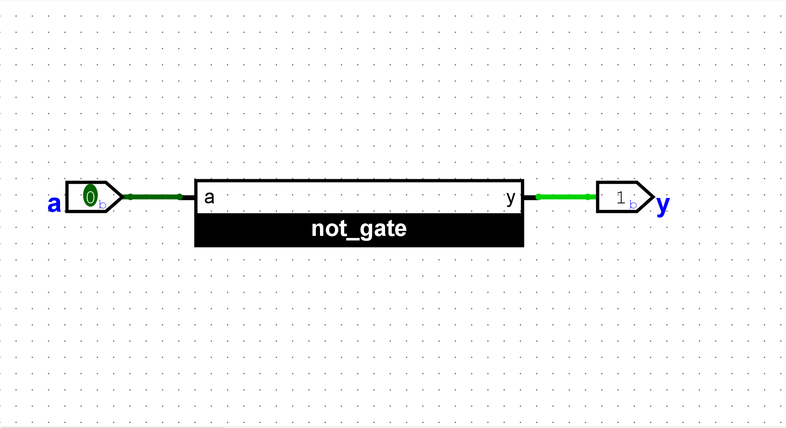
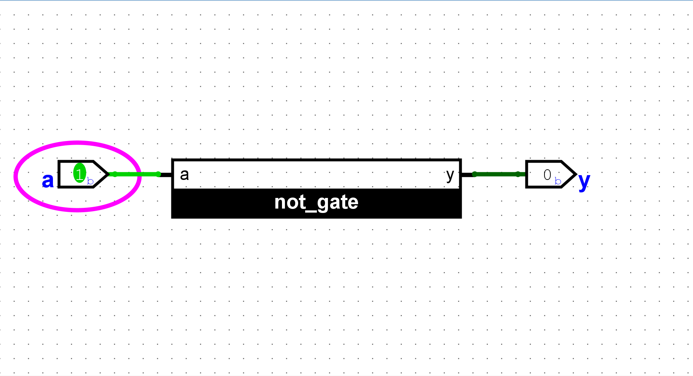
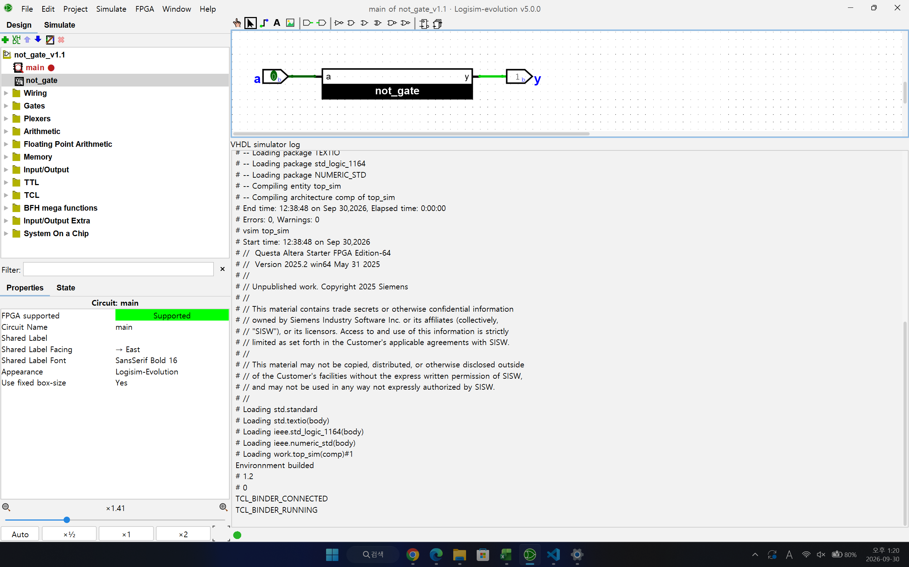

# Assignment 1: NOT Gate in VHDL

A NOT gate written in VHDL, imported into Logisim-evolution, and simulated with Questa co-simulation.

## Files

| File | Description |
|---|---|
| [not_gate.vhd](not_gate.vhd) | VHDL source (entity `not_gate`, architecture `behavioral`) |
| [not_gate_v1.1.circ](not_gate_v1.1.circ) | **Final** Logisim-evolution project used for the simulation |
| [not_gate_v1.0.circ](not_gate_v1.0.circ) | Early draft project (before renaming and wiring), kept for history |
| [PDF report](<report/디지털 논리 회로 설계 VHDL과제.pdf>) | Report with code, circuit, screenshots, and results |
| [images/](images/) | Simulation screenshots |

## Results

| a | Expected y | Simulated y |
|---|---|---|
| 0 | 1 | 1 |
| 1 | 0 | 0 |

**a = 0 → y = 1**

**a = 1 → y = 0**

**Questa co-simulation running (TCL_BINDER_RUNNING in the log)**

## Tools

- Questa Altera Starter FPGA Edition 2025.2
- Logisim-evolution 5.0.0 (VHDL-2002)